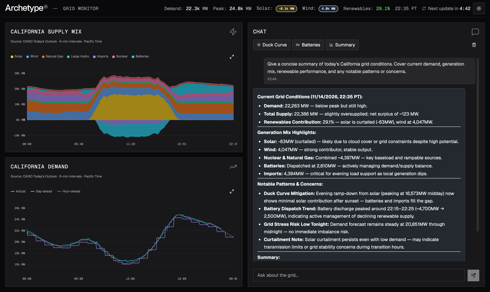

# Newton Grid Monitor (Inference API)

Real-time California power grid dashboard powered by [Newton](https://www.archetypeai.io/) and [CAISO](https://www.caiso.com/) (California Independent System Operator).

Visualizes the California electricity grid's supply mix and demand in real-time with 5-minute resolution. Newton analyzes grid conditions, renewable performance, duck curve patterns, and battery dispatch.

This is the Inference API version of [archetypeai-grid-demo](https://github.com/archetypeai/archetypeai-grid-demo), which uses the Direct Query API. [MIGRATION.md](MIGRATION.md) explains what changed and compares the two.



## Features

- **Supply mix stacked area chart** — Solar, Wind, Natural Gas, Hydro, Nuclear, Batteries, Imports stacked over 24h
- **Demand line chart** — current demand vs day-ahead and hour-ahead forecasts
- **Stats bar** — live demand, peak, solar/wind output, renewable percentage
- **Newton chat** — ask about duck curve, battery strategy, grid stress, renewable performance
- **Quick prompts** — Duck Curve, Batteries, Summary one-click analysis
- **Expandable charts** — fullscreen any chart for detailed viewing
- **Auto-refresh** — data updates every 5 minutes matching CAISO cadence

## Stack

- **SvelteKit** with Svelte 5 runes
- **Archetype AI Design System** — semantic tokens, component primitives, composite patterns
- **Geist and Geist Mono** — open-source fonts from `@fontsource-variable`
- **Newton Inference API** — Newton C 2.6 (`newton-c-2.6`) through the stateless query endpoint (`POST /api/inference/query`); no session
- **CAISO Today's Outlook** — public CSV feeds for demand and supply (5-min intervals)
- **Tailwind v4** — styling with semantic design tokens

## Setup

Requires Node.js 20 or later:

```bash
git clone https://github.com/archetypeai/archetypeai-grid-demo-model-serving.git
cd archetypeai-grid-demo-model-serving
npm install
cp .env.example .env      # then add your API key
```

`.env` holds your Archetype AI API key and the production endpoint:

```
ATAI_API_KEY=your_api_key_here
ATAI_API_ENDPOINT=https://platform.u1.archetypeai.app
```

The `.env` file wins over any `ATAI_*` variables exported in your shell (see `vite.config.js`).

## Development

```bash
npm run dev
```

Open `http://localhost:5173`. Grid data loads automatically. Use the chat to ask Newton questions.

## Data Sources

| Endpoint | Data | Update Frequency |
|----------|------|-----------------|
| `caiso.com/outlook/history/{YYYYMMDD}/demand.csv` | Demand forecasts + actuals | 5 min |
| `caiso.com/outlook/history/{YYYYMMDD}/fuelsource.csv` | Generation by fuel source | 5 min |

## How It Works

1. Server fetches today's demand and supply CSVs from CAISO (288 rows/day at 5-min intervals)
2. Supply chart renders a stacked area showing the generation mix — solar dominates midday, gas ramps for evening
3. Demand chart overlays actual demand against day-ahead and hour-ahead forecasts
4. Chat sends recent grid data (last hour of demand + supply) as context to Newton C 2.6 on the Inference API (`POST /api/inference/query`)
5. Newton reasons about grid conditions: duck curve timing, renewable curtailment, battery dispatch, peak stress

## Latency

Measured on production on 2026-11-14, with the five example questions below and the three quick prompts, on that day's data cut at noon, 6 pm and late evening:

| | Time per answer | Median |
| --- | --- | --- |
| Example questions | 7–11 s | 8 s |
| Quick prompts (Duck Curve, Batteries, Summary) | 9–13 s | 12 s |

The first query after a quiet spell can take 30–40 s longer while the model warms up.

## Known Limitations

- **Short answers.** The Inference API stops a query after about 58 seconds, so the prompt asks for answers under 300 words and caps them at 1,536 tokens. Longer, unbounded answers timed out.
- **Last hour only.** Newton sees the current totals, today's peaks and the last hour of 5-minute data, not the whole day, so questions about the morning or midday are answered from the peaks alone (as in the Direct Query version).

## Example Questions for Newton

- "Explain today's duck curve — when does solar peak and what happens at sunset?"
- "How are batteries being used today? When do they charge vs discharge?"
- "Is current demand higher or lower than the day-ahead forecast? Why might that be?"
- "What percentage of generation is from renewables right now?"
- "Are there signs of grid stress or tight supply conditions?"

## Licence

The code is licensed under the [Apache License 2.0](LICENSE). Grid data is fetched live from [CAISO Today's Outlook](https://www.caiso.com/todays-outlook) and is not part of this repository.
